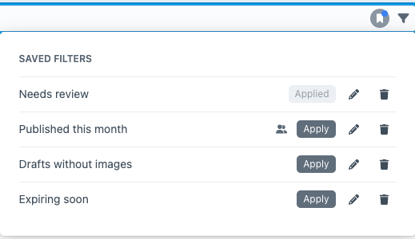

# Saved Filters for Craft CMS

Save and reapply element index filters in the Craft control panel.

A bookmark button sits beside the filter button on every element index page. Filters are saved per element type and source (section), so each one only appears where it was created.



## Requirements

- Craft CMS 5.0 or later
- PHP 8.2 or later

## Installation

```bash
composer require zesda/craft-saved-filters
php craft plugin/install saved-filters
```

## Usage

- Build a filter, then click **Save** next to **Apply** in the filter panel. Name it, then choose **Save** or **Save & apply**.
- Open the bookmark button to apply, edit or delete saved filters for the current source. A dot marks a filter you've just saved.
- Users with the **Create shared filters** permission, and admins, can share a filter with all users. Shared filters show a two-person icon and can be unshared from the edit modal.
- On narrow screens the saved filters dropdown becomes a centred modal, matching Craft's own filter dropdown.

Filters are private to their owner unless shared. Everyone can save, apply, edit and delete their own filters.

## Permissions

Permissions only govern shared filters. Admins have all of them. Other users need them granted under **Saved Filters** in their user group or user permissions:

- **View shared filters**: lets the user see and apply filters that other users have shared. Without it they only see their own.
- **Create shared filters**: lets the user share and unshare their own filters.
- **Edit filters shared by other users**: lets the user rename shared filters they don't own.
- **Delete filters shared by other users**: lets the user delete shared filters they don't own.

The last three are nested under **View shared filters**.

## Notes

The button script relies on Craft's element index JavaScript (`Craft.elementIndex`, `createFilterHud`), which isn't a public API, and may need adjusting after Craft upgrades. If those globals aren't present the plugin does nothing.
